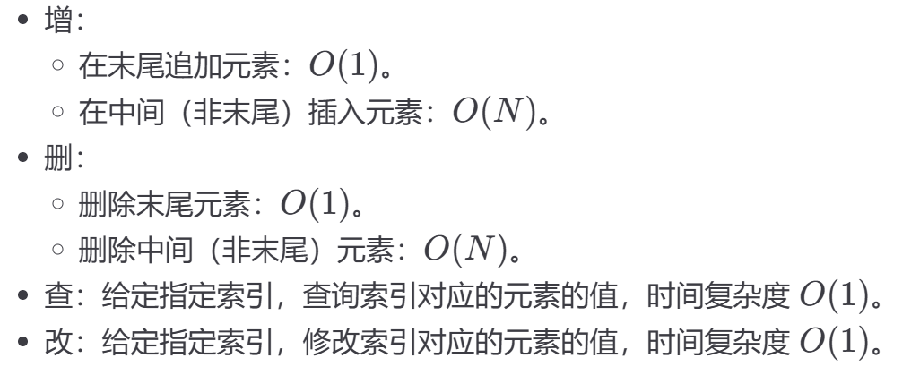

# 数组
## 静态数组
```java
int[] arr = new int[10];
//定义静态数组
arr[0]=2;
//使用索引赋值
int a = arr[0];
//使用索引取值
```
1. 为什么数组的索引从 0 开始？就是方便取地址。arr[0] 就是 arr 的首地址，从这个地址往后的 4 个字节存储着第一个元素的值；arr[1] 就是 arr 的首地址加上 1 * 4 字节，也就是第二个元素的首地址，这个地址往后的 4 个字节存储着第二个元素的值。arr[2], arr[3] 以此类推。

2. 因为数组的名字 arr 就指向整块内存的首地址，所以数组名 arr 就是一个指针。你直接取这个地址的值，就是第一个元素的值。也就是说，*arr 的值就是 arr[0]，即第一个元素的值。

3. 如果不用 memset 这种函数初始化数组的值，那么数组内的值是不确定的。因为 int arr[10] 这个语句只是请操作系统在内存中开辟了一块连续的内存空间，你也不知道这块空间是谁使用过的二手内存，你也不知道里面存了什么奇奇怪怪的东西。所以一般我们会用 memset 函数把这块内存空间的值初始化一下再使用。

增
```java
// 大小为 10 的数组已经装了 4 个元素
int[] arr = new int[10];
for (int i = 0; i < 4; i++) {
    arr[i] = i;
}

// 现在想在数组末尾追加一个元素 4
arr[4] = 4;

// 再在数组末尾追加一个元素 5
arr[5] = 5;

// 依此类推
// ...
```
插入
```java
import java.util.Scanner;
public class Hello {
	public static void main(String[] args) {
		Scanner input = new Scanner(System.in);
		int[] arr = new int[10];
		for(int i = 0;i<4;i++) {
			arr[i]=input.nextInt();
		}//在第二个元素后插入数字
		for(int i = 4;i>1;i--) {
			arr[i+1]=arr[i];
		}
		arr[2]=666;
		for(int i = 0;i<5;i++) {
			System.out.print(" "+arr[i]);
		}
		input.close();
		}
}
```
## 总结

